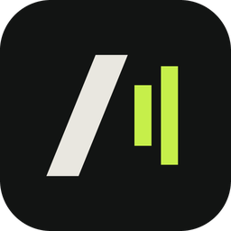
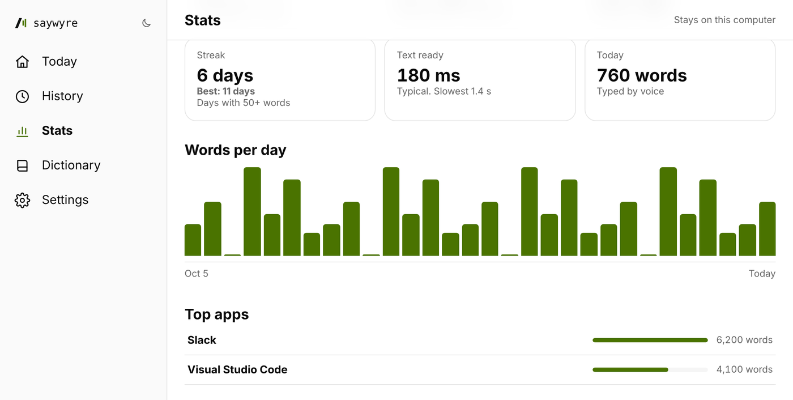

# Saywyre

**Talk instead of type.** Hold a shortcut, say it, let go. Your words appear wherever you're typing.

Free for Windows, macOS and Linux.

macOS needs an Apple silicon Mac (M1 or newer). Installing on Linux? .AppImage runs anywhere, .deb for Ubuntu/Debian ([get the .deb](https://github.com/ThatFellowDev/saywyre-releases/releases/latest/download/Saywyre-Linux.deb)).

  

<picture>
  <source media="(prefers-color-scheme: dark)" srcset="assets/stats-dark.png">
  
</picture>

## What you get

<table>
<tr><td width="56"></td><td><b>Works in any app.</b> Email, chat, docs, your code editor. If it has a cursor, you can talk into it.</td></tr>
<tr><td></td><td><b>Runs on your computer.</b> Your voice turns into text on your own machine, so it keeps working offline.</td></tr>
<tr><td></td><td><b>Cleans up as you go.</b> The "um"s and "uh"s come out before the text lands.</td></tr>
<tr><td></td><td><b>Learns your words.</b> Add the names and terms you use, and Saywyre spells them right.</td></tr>
<tr><td></td><td><b>Shows your progress.</b> Search everything you said and see your words per day, streak and time saved.</td></tr>
</table>

## Everything it does

**Talking**
- Hold a shortcut (Alt + Shift + Space by default), talk, let go, and the text is typed into the app you were in. Or tap once to start and once to stop.
- A small pill shows when Saywyre is listening, with your words as you say them (live captions). Pick its style: Dots, Bars, Line or Light.
- Light cleanup drops "um" and "uh", or keeps every word if you prefer. It never changes what you meant.
- Silence and stray sounds are not typed. A take with almost no voice in it, or an "Okay" or "Mm-hmm" from a breath or a key click, stays out of your text and is kept in History marked as not typed.
- Say "new paragraph" or "new line" for line breaks. Add snippets, so saying "my calendar link" types the link.
- Paste last take types your last take again if it landed in the wrong place (Ctrl + Alt + V by default).
- Per-app styles set how much cleanup applies in each app.
- Show where text went: a soft glow, or a small chip that flies from the pill to where your words landed.
- If your mic level is far below a usual speaking level, Saywyre tells you, at most once a day. Settings has a live level meter.

**Speech models**
- Everything runs on your computer's processor. Built-in choices: Parakeet Unified EN, Parakeet TDT v3, Whisper Turbo, Whisper Small English and Moonshine Small.
- Each language has one model marked Recommended, and the one that fits your computer is marked Best fit for this PC. Test speed measures a model on your machine.
- Add your own by pasting a Hugging Face link or choosing a .gguf file. Saywyre checks that it can run it and shows its family, size and license.

**Your words**
- Add up to 1,000 words, each with up to 20 ways it is misheard, and later takes spell them your way. Saywyre also fixes spellings that sound like one of your words.
- In History, Fix a word corrects a take and can add the word to your list. Stats suggests words you may want to add.

**History, Stats and audio**
- Every take is saved on your computer. Search it, copy from it, and filter by day or range. History is kept forever by default, or for the time you choose.
- Keep audio saves each take's recording so you can play it back, save a copy or drag the file into another app. Record only keeps the audio and types nothing, for voice notes.
- Stats shows words, pace, time saved, filler words and more. Share turns it into a square or story image.
- Move to another computer exports and imports your words, snippets, settings, history, stats and recordings, whichever you tick.

**Read aloud**
- Select text and have it read to you by a voice that runs on your computer, with captions that follow along, a speed control and its own shortcut. On Windows you can also drag a box over any text on screen. Or point it at your own OpenAI-compatible speech server.

**Everyday**
- Light and dark themes, a tray menu, and updates that install only when you say so.
- On Linux, the talk key works on X11 and mostly not on Wayland yet.

Each release page lists what changed in that version.

## Install

<b>Windows</b>

1. [Download the installer](https://github.com/ThatFellowDev/saywyre-releases/releases/latest/download/Saywyre-Windows-Setup.exe) and run it.
2. If Windows says it protected your PC, click **More info**, then **Run anyway**. The installer isn't code-signed yet.

<b>Linux</b>

Pick one:

- **Ubuntu or Debian:** [download the .deb](https://github.com/ThatFellowDev/saywyre-releases/releases/latest/download/Saywyre-Linux.deb), then run `sudo apt install ./Saywyre-Linux.deb`.
- **Any distro:** [download the .AppImage](https://github.com/ThatFellowDev/saywyre-releases/releases/latest/download/Saywyre-Linux.AppImage), run `chmod +x Saywyre-Linux.AppImage`, then open it.

Both are for 64-bit Intel and AMD computers. If the AppImage won't open, install libfuse2 (`sudo apt install libfuse2t64` on Ubuntu 24.04).

<b>macOS</b>

1. [Download the .dmg](https://github.com/ThatFellowDev/saywyre-releases/releases/latest/download/Saywyre-macOS.dmg) and open it.
2. Drag Saywyre into Applications.

This build is for Apple silicon Macs (M1 or newer).

<b>What are the other files on the release page?</b>

- `.sig` files and `.tar.gz` files power auto-update inside the app. You never need to download them.
- `latest.json` tells the app which version is newest.
- "Source code (zip)" and "Source code (tar.gz)" are added by GitHub to every release automatically. This repo only holds the installers and this page, so those two files have nothing you need.

On first start, Saywyre downloads its speech model. After that, hold **Alt + Shift + Space**, talk, and let go. If another app already uses that shortcut, Saywyre picks a free one and shows it on the Today screen. You can change it any time.

## Your privacy

Your voice and your words stay on your computer. Speech is turned into text on your machine, and once a speech model is downloaded, Saywyre works offline. It needs no account and sends no usage counts and none of your text.

Your history, stats and recordings live on your computer. **Keep audio** saves your last 1,000 takes, up to 1 GB, so you can play them back. Switch it off in Settings to save none, or delete saved audio any time.

The internet is used for three things: downloading a speech model or the read-aloud voice when you ask for one, checking for updates, and read aloud if you choose your own voice server (only the text you read aloud goes there).

## Updates

Saywyre checks this page for new versions and downloads nothing until you click to install. Each update is signed, and Saywyre refuses one whose signature doesn't match. You can also check from **Settings > About**.

## Help

Found a bug or have a question? [Open an issue](https://github.com/ThatFellowDev/saywyre-releases/issues). Say which computer you use, the Saywyre version (Settings > About) and what you did. Do not paste anything you said or typed.

---

Saywyre is free to download and use. Made by [Postwyre](https://postwyre.com).

